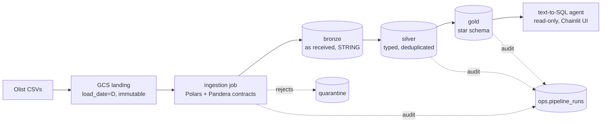

# Olist Warehouse

[](https://github.com/clnhrn/olist-warehouse/actions/workflows/pr.yml)
[](https://github.com/clnhrn/olist-warehouse/actions/workflows/deploy.yml)

A production-style data warehouse on GCP, built on the [Olist Brazilian E-Commerce dataset](https://www.kaggle.com/datasets/olistbr/brazilian-ecommerce) (~100k orders, 9 source files). Raw CSVs go through data contracts into a medallion warehouse (bronze, silver, gold) with a Kimball star schema, deployed by Terraform and GitHub Actions, and running daily for about zero cost. A text-to-SQL agent answers business questions from the gold layer.

## Architecture



Daily at 06:00 (America/Sao_Paulo): Cloud Scheduler → Workflow → ingestion job → dbt job, all on Cloud Run. The same dbt project runs on DuckDB locally and on BigQuery in dev and prod.

| Layer | Datasets (prod / dev) | Guarantees |
|---|---|---|
| Bronze | `bronze` / `dev_bronze` | Source data exactly as received, plus `_loaded_at`, `_load_date`, `_source_file`. Every row passed its contract; failing rows are in `bronze.quarantine`. |
| Silver | `silver` / `dev_silver` | Typed and deduplicated, latest row per key. |
| Gold | `gold` / `dev_gold` | Facts and dimensions with enforced dbt model contracts. |
| Ops | `ops` / `dev_ops` | Audit log (`pipeline_runs`) and stored test failures. |

## Highlights

- **Data contracts.** One versioned YAML per source file generates both the Pandera validation and the BigQuery schema. Bad rows go to quarantine (up to 1%), and anything structural stops the batch. → [ingestion](docs/ingestion.md)
- **Idempotent in every layer.** Rerunning a load date changes no row count in any of the 29 tables, proven by a `check-rerun` command rather than asserted. Silver orders by batch date, so rerunning an old batch never beats newer data. → [idempotency](docs/idempotency.md)
- **Star schema with enforced contracts.** 4 facts and 5 dimensions, surrogate keys, unknown members, and the same contract YAML enforced on DuckDB and BigQuery with identical results. → [dbt models](docs/dbt-models.md), [design](docs/star-schema-design.md)
- **Schema evolution by contract version.** Renames and new columns flow through without a full refresh, and breaking changes are refused at job start. → [schema evolution](docs/schema-evolution.md)
- **SCD2 rebuilt from bronze, not a dbt snapshot.** Seller history survives a fresh rebuild row for row, which a snapshot would not. → [SCD2](docs/scd2.md)
- **Audit trail and alerts.** One run id across ingestion and dbt in `ops.pipeline_runs`, stored failing rows for warning tests, and email alerts on failed jobs. → [data quality](docs/data-quality.md)
- **Keyless CI/CD.** Workload Identity Federation with two CI accounts: pull requests can never deploy, and a guardrail job proves it on every PR. Merges apply Terraform, push images, and run prod dbt. → [security and CI](docs/security-and-ci.md)
- **Text-to-SQL agent with honest numbers.** Claude writes SQL over gold from the dbt descriptions and a small semantic layer, runs it as a read-only service account with a byte cap, and explains the result. Every number in the explanation is filled in from the result by code, never typed by the model. 50/50 on a 53-question eval with reference SQL, 49/49 faithful explanations, at under a cent per question. → [agent](docs/agent.md)
- **About zero cost.** Everything fits the GCP free tiers. → [operations](docs/operations.md#cost)

## Stack

| Concern | Tools |
|---|---|
| Ingestion | Python 3.12, Polars, Pandera, uv |
| Warehouse | BigQuery (dev and prod), DuckDB (local) |
| Transformation | dbt (BigQuery and DuckDB adapters), dbt_utils, SQLFluff |
| Orchestration | Cloud Run jobs, Cloud Workflows, Cloud Scheduler |
| Infrastructure | Terraform with GCS remote state, Artifact Registry |
| CI/CD | GitHub Actions, Workload Identity Federation |
| Monitoring | Cloud Monitoring alerts, `ops.pipeline_runs` |
| Agent | Claude Sonnet 5.5 (Anthropic API), sqlglot, Chainlit, Plotly, Secret Manager |

## Quick start (local, no GCP)

Needs the dataset in `data/raw/` ([setup/README.md](setup/README.md) downloads it).

```bash
uv sync
uv run python -m ingestion land   --load-date 2016-01-01 --sink local
uv run python -m ingestion ingest --load-date 2016-01-01 --sink local
cd dbt && uv run dbt build --target local
```

This writes the lake under `data/` and builds silver and gold in `data/warehouse.duckdb`. Dev BigQuery, prod, tests, and lint: [operations](docs/operations.md#how-to-run).

## Repository layout

```
contracts/    versioned source contracts (v1/, v2/) and the loader with the breaking-change check
ingestion/    the ingestion job: land, ingest, check-rerun
dbt/          silver and gold models, macros, tests, seeds
agent/        text-to-SQL agent, semantic layer, evals, Chainlit UI
terraform/    all GCP infrastructure, including CI identities
.github/      pull request checks and deploy on merge
scripts/      simulated batches 2 (schema change) and 3 (seller changes)
setup/        one-time tool install, GCP bootstrap, dataset download
tests/        pytest for contracts, ingestion, and the agent
docs/         design and topic docs
```

## Docs

| Doc | What it covers |
|---|---|
| [ingestion.md](docs/ingestion.md) | Contracts, the job, lake layout |
| [idempotency.md](docs/idempotency.md) | Reruns in every layer, the rerun check |
| [dbt-models.md](docs/dbt-models.md) | Silver, gold, tests, contracts, partitioning |
| [star-schema-design.md](docs/star-schema-design.md) | Grain and column design, with the data findings behind it |
| [schema-evolution.md](docs/schema-evolution.md) | What source changes are accepted or blocked, and why |
| [scd2.md](docs/scd2.md) | Seller history from bronze |
| [data-quality.md](docs/data-quality.md) | Quarantine, audit log, stored failures, alerts |
| [security-and-ci.md](docs/security-and-ci.md) | Service accounts, Workload Identity Federation, CI/CD |
| [agent.md](docs/agent.md) | The text-to-SQL agent: guardrails, semantic layer, evals, UI |
| [operations.md](docs/operations.md) | Infrastructure, pipeline, how to run, rollout lessons, cost |
| [implementation-plan.md](docs/implementation-plan.md), [progress.md](docs/progress.md) | The phased plan and its status |

## License

The code is under the [MIT License](LICENSE). The data is not in this repo, apart from a seed that translates two Olist category names. The [Olist Brazilian E-Commerce dataset](https://www.kaggle.com/datasets/olistbr/brazilian-ecommerce) is by Olist and is licensed under [CC BY-NC-SA 4.0](https://creativecommons.org/licenses/by-nc-sa/4.0/), so it may not be used commercially.
