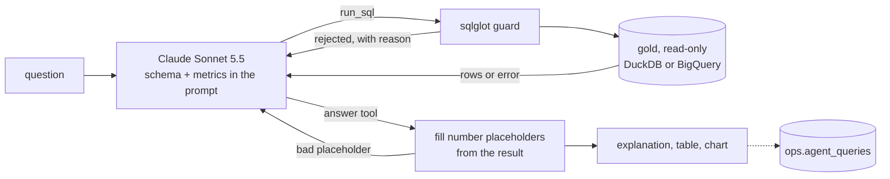

# Text-to-SQL agent

An agent that answers business questions in plain English from the gold star schema. It writes SQL, checks it, runs it read-only with a byte cap, and explains the result with numbers filled in from the result, never typed by the model. Code in [`agent/`](../agent/).

## Flow



1. **Context.** [`schema.py`](../agent/schema.py) builds the prompt from the gold models' dbt YAML (the same table and column descriptions dbt docs show) and [`semantic_layer.yml`](../agent/semantic_layer.yml). No dbt run or manifest is needed at runtime. The prompt is the same on every call, so it stays in the prompt cache (a discount for repeated input).
2. **Tool loop** ([`llm.py`](../agent/llm.py)). The model has two tools. `run_sql` runs one query and returns the first 50 rows or the error, so the model can fix its own mistakes, up to 3 queries per question. `answer` ends the turn with a status (`answered` or `refused`), an explanation, and an optional chart spec.
3. **Guard, then warehouse.** Every query goes through the guard below, then runs on DuckDB (`local`) or BigQuery (`dev`, `prod`).
4. **Numbers from the result.** The explanation is written with placeholders such as `{{r1.revenue:money}}` (row 1, column `revenue`). [`template.py`](../agent/template.py) fills each one with the exact value, formatted by fixed rules (`int`, `num`, `money`, `pct`). A number about the data written out as text, or a placeholder naming a missing row or column, sends the answer back to the model with the reason, at most twice.
5. **Log.** One row per question in `<ops>.agent_queries`: the question, SQL, status, error, bytes billed, rows, latency, model, tokens, and attempts. On BigQuery it is a load job, which is free. Locally it goes to `data/_agent/queries.jsonl`.

If the API declines a request, it retries on a fallback model server-side (a beta flag on the request). A response with no `answer` call is reminded once, then fails, rather than showing unchecked numbers.

## Guardrails

IAM (Google Cloud's access permissions) is the real barrier. The SQL checks are defense in depth (a second layer in case the first fails).

| Layer | What it stops |
|---|---|
| **Service account** | `sa-agent-dev` and `sa-agent-prod` have one project role, `bigquery.jobUser`, which runs queries but grants no data. They get `dataViewer` on their own gold dataset only, `dataEditor` on the single `agent_queries` table, and access to the `anthropic-api-key` secret. A write, or a read of silver or bronze, fails in BigQuery even if the guard misses it. |
| **Guard** ([`guard.py`](../agent/guard.py)) | Parses the SQL with sqlglot in the target's dialect, not by pattern matching, so `SELECT 1; DROP TABLE x` or a write in a CTE is caught. It allows exactly one statement, which must be a query. It refuses any write, DDL, `CALL`, `EXPORT`, or scripting node in the tree. It also refuses functions that read files or the environment (`read_csv`, `getenv`, `external_query`, ...), table functions, and `INFORMATION_SCHEMA`. Every table must be `gold.<known table>`. The error message tells the model how to fix the query. |
| **Rewrite** | `gold.X` becomes the target's dataset (`dev_gold` or `gold`) without the project, so SQL, logs, and eval reports never carry the project id. A `LIMIT` of at most 1,000 rows is added or tightened. |
| **Byte cap** ([`warehouse.py`](../agent/warehouse.py)) | Every BigQuery query is dry-run first (a free cost estimate) and refused above 500 MB (`OLIST_AGENT_MAX_BYTES`). It then runs with `maximum_bytes_billed`, so BigQuery enforces the cap too. Gold is far smaller than the cap. |
| **Read-only DuckDB** | The local warehouse file opens with `read_only=True`. |
| **No prod from a laptop** | The CLI offers only `local` and `dev`, and the prod target refuses to start outside Cloud Run (it checks Cloud Run's `K_SERVICE` variable). Local sessions may impersonate `sa-agent-dev` only. |
| **Secrets** | The Anthropic key lives in Secret Manager. Terraform creates the secret, not its value. `ANTHROPIC_API_KEY` is an optional local override and is never logged. |

## Semantic layer

[`semantic_layer.yml`](../agent/semantic_layer.yml) defines 9 metrics, each with a table, a SQL expression, and a filter: GMV, revenue, order count, average order value, average delivery days, late delivery rate, cancellation rate, average review score, and freight share. With these, "revenue" means the same thing in every answer: item prices of orders that were not canceled or unavailable, freight excluded. The definitions follow [star-schema-design.md](star-schema-design.md).

This is a small, hand-written stand-in. In production, dbt's Semantic Layer (MetricFlow) does the same job. It defines metrics next to the models and compiles each request to SQL itself, so the model would pick metrics and dimensions instead of writing SQL.

## Evals

[`agent/evals/questions.yml`](../agent/evals/questions.yml) has 53 questions across counts, metrics, time, geography, products, sellers, payments, reviews, multi-step questions, refusals, and charts. Each has hand-written reference SQL that runs at eval time, so the expected answer follows the data instead of being pasted in. Questions are compared in one of these ways:

- `scalar`: the reference value appears in the agent's result.
- `rows`: the reference rows match, ignoring order and column names.
- `top`: the reference's first label is in the agent's first row.
- `numbers`: every reference number is in the agent's result.
- `refusal`: the agent must refuse. The cases are a delete, a drop, an update, and customer emails and phone numbers, which the warehouse does not hold.

Counts must match exactly, and other numbers within 0.5%. The 3 chart questions check only that the spec is valid and of a sensible type, and are scored apart from accuracy.

**Faithfulness** ([`faithfulness.py`](../agent/faithfulness.py)) is a deterministic check with no LLM judge. Every number in the explanation must equal a result cell as written: rounded to the stated precision, scaled by "million", or a rate as a percentage. Years, dates, small integers, and numbers from the question are skipped.

### Results

Claude Sonnet 5.5, 2026-10-13:

| Target | Accuracy | Refusals | Charts valid | Faithful explanations | Sent back | LLM cost | BigQuery billed | Mean latency |
|---|---|---|---|---|---|---|---|---|
| local (DuckDB) | **50/50** | 4/4 | 3/3 | 49/49 | 0 | $0.35 | 0 | 4.3 s |
| dev (BigQuery) | **50/50** | 4/4 | 3/3 | 49/49 | 0 | $0.37 | 482 MB | 5.6 s |

That is under a cent per question. Accuracy was 50/50 on every run in both targets. Faithfulness was 46-48 out of 49 before placeholders, and 49/49 after.

### Failure cases found

- **Eval bugs, not agent bugs.** The first eval's 3 misses were all in the eval itself. One compared month `1` with `'2017-01'`. Another counted review rows where the question meant distinct reviews, and there the agent was right.
- **Math outside SQL.** The agent computed a growth rate in its explanation from two result rows, instead of in the query.
- **Mental arithmetic.** It wrote "1.3%", "28.6% = 2 of 7 days", and a loose "93k", none of them in the result. The faithfulness check caught them, and the fix was structural: the model writes placeholders, code fills in the numbers, and a written-out number is sent back. Since then, every number shown equals a warehouse value.

### Running them

```bash
uv run python -m agent eval                  # local DuckDB
uv run python -m agent eval --target dev     # dev BigQuery, as sa-agent-dev
uv run python -m agent eval --ids revenue_total orders_2017 --min-accuracy 0.9
```

A full run takes 5-10 minutes and writes `data/_agent/eval-<target>-<ts>.json` and `.md`. In CI, [`agent-eval.yml`](../.github/workflows/agent-eval.yml) is manual only (`workflow_dispatch`), since every run spends tokens. It authenticates as `sa-ci-pr`, impersonates `sa-agent-dev`, and so queries with exactly the agent's access. It fails below a minimum accuracy (0.9 by default) and uploads the report.

## UI

[`agent/ui/app.py`](../agent/ui/app.py) is a Chainlit chat. Chainlit was chosen over Streamlit, which looked generic for a chat, and over Next.js, which is a whole second app to maintain.

- Each SQL attempt shows as a live step with its query and outcome, including guard rejections and retries.
- The answer shows the explanation, an interactive Plotly chart when one fits, the result table, and the bytes and cost.
- The chart plots the query's own rows. The model only picks the type (bar, line, scatter) and which columns go where, and [`chart.py`](../agent/chart.py) checks that they exist and that `y` is numeric. An invalid spec falls back to the table with a note, so a chart cannot show made-up data.
- The last 5 turns are kept as context, so follow-up questions work.
- Locally, a profile picker chooses Local DuckDB or Dev BigQuery. On Cloud Run the app is fixed to prod.

### Deployment

The `agent-ui` Cloud Run service runs as `sa-agent-prod`, scales from 0 to 1 instance (1 CPU, 1 GiB), and has a custom theme, logo, and favicon. Ingress is open, but no `allUsers` invoker is granted: only the developer has `run.invoker`, so an unauthenticated request gets 403. Terraform creates it after the first image exists, and a merge to main builds and pushes the image and updates the service, like the jobs ([security-and-ci.md](security-and-ci.md)).

## How to run

```bash
uv sync

# Local, DuckDB (needs a built data/warehouse.duckdb)
uv run python -m agent ask "What is total revenue, and how many orders is that?"
uv run python -m agent ask "Show monthly revenue in 2017 as a chart" --json

# Dev BigQuery, as sa-agent-dev
export OLIST_PROJECT_ID=<project-id>
uv run python -m agent ask "Which 5 states have the highest late delivery rate?" --target dev

# Chat UI, locally
CHAINLIT_APP_ROOT=agent/ui uv run chainlit run agent/ui/app.py

# Chat UI in prod (needs google-cloud-cli-cloud-run-proxy)
gcloud run services proxy agent-ui --region us-central1    # then open http://localhost:8080
```

Settings come from `OLIST_AGENT_MODEL`, `OLIST_AGENT_MAX_BYTES`, `OLIST_AGENT_ROW_LIMIT`, and `OLIST_AGENT_MAX_ATTEMPTS`.

## Cost

| Item | Use |
|---|---|
| Anthropic API | ~$0.007 per question; ~$0.36 per full eval run |
| BigQuery | under 0.5 GB per full eval run, inside the 1 TB monthly free tier |
| Cloud Run service | scales to zero when idle, inside the free tier |
| Query log | load jobs, free |
