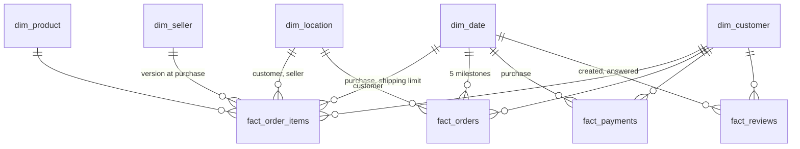

# Grain and star schema design

The gold layer design: fact grains, dimensions, keys, and measures, plus the data findings behind each decision. Grains confirmed on 2026-10-08. Built in Phase 4, with `dim_seller` history added in Phase 6. Money columns are `numeric(18, 2)`, durations `numeric(10, 2)`, coordinates `numeric(9, 6)`.

## Data findings that shape the design

Profiled from the full source files (99,441 orders, 2016-09-04 to 2018-10-17).

| Finding | Effect on the design |
|---|---|
| 775 orders have no items (603 unavailable, 164 canceled, 8 other) | `fact_orders` keeps them (needed for cancellation rates); `fact_order_items` has no rows for them |
| 1,278 orders have items from more than one seller | Seller belongs on `fact_order_items`, not on `fact_orders` |
| 6,968 orders repeat the same product on several rows | Quantity is "one row per unit"; item count is `COUNT(*)`, not a quantity column |
| Payments equal items + freight for 98,362 of 98,665 orders; 264 paid more (installment interest), 39 paid less | Revenue comes from items; payments are a separate fact, never allocated to items |
| 1 order has no payment; 3 payments have type `not_defined`; 2 have 0 installments | Kept as-is; flagged by tests, not dropped |
| 547 orders have more than one review; 789 `review_id`s are shared by several orders | `fact_reviews` grain is `(review_id, order_id)`; count reviews with `COUNT(DISTINCT review_id)` |
| 96,096 people placed the 99,441 orders (`customer_id` is per order); 2,997 people ordered more than once; 250 used more than one zip | `dim_customer` is per person; order-time address goes through `dim_location` |
| 8 delivered orders have no delivery date; 6 undelivered orders have one | Delivery measures are null when the date is missing; a flag marks status/date mismatches |
| 610 products have no category; 13 products use 2 categories missing from the translation table | `category_en` falls back: a seed adds the 2 missing translations, null becomes `unknown` |
| Geolocation: 19,015 zips, 8,556 with several city spellings; 278 customer zips and 7 seller zips are missing from it | `dim_location` is one row per zip from all sources, with the most common spelling and median coordinates; missing zips get null coordinates |
| Dates range from 2016-09-04 (first order) to 2020-04-09 (one shipping limit outlier) | `dim_date` covers 2016-01-01 to 2020-12-31, which also covers the SCD2 baseline date |

## Bus matrix

Which dimensions each fact uses. "Role" means the same dimension used more than once under different names.

| Fact | Grain | date | customer | location | product | seller |
|---|---|---|---|---|---|---|
| `fact_order_items` | one row per order item | purchase, shipping limit | yes | customer, seller | yes | yes (SCD2) |
| `fact_orders` | one row per order | purchase, approved, shipped, delivered, estimated | yes | customer | | |
| `fact_payments` | one row per payment record | purchase | yes | | | |
| `fact_reviews` | one row per review per order | created, answered | yes | | | |

## Facts

All facts keep `order_id` as a degenerate dimension (an identifier with no dimension table). Every foreign key is non-null: missing references point to the dimension's unknown member.

### fact_order_items

**Grain:** one row per order item, key `(order_id, order_item_id)`. 112,650 rows.

| Column | Notes |
|---|---|
| `order_id`, `order_item_id` | Degenerate key |
| `purchase_date_key`, `shipping_limit_date_key` | `dim_date` roles |
| `purchased_at` | Order purchase timestamp, the partitioning column (BigQuery partitions on a date or timestamp column, not on an integer date key) |
| `customer_key`, `customer_location_key` | Same values as on `fact_orders`, so item revenue can be sliced by customer and region without joining facts |
| `product_key` | `dim_product` |
| `seller_key` | The `dim_seller` version valid at purchase time (see SCD2 below) |
| `seller_location_key` | Location of that seller version |
| `order_status` | Degenerate attribute, so revenue can be filtered by status (for example, excluding canceled orders) |
| `price` | Item revenue |
| `freight_value` | Freight charged for this item (already item level in the source) |
| `item_total` | `price + freight_value` |

Partitioned by purchase date (monthly), clustered by `seller_key`, `product_key`.

### fact_orders (accumulating snapshot)

**Grain:** one row per order, key `order_id`. 99,441 rows, including the 775 with no items. The row is updated as the order moves through its milestones.

| Column | Notes |
|---|---|
| `order_id` | Degenerate key |
| `customer_key`, `customer_location_key` | Location is the zip on this order's `customer_id` |
| `purchase_date_key`, `approved_date_key`, `shipped_date_key`, `delivered_date_key`, `estimated_delivery_date_key` | `dim_date` roles; unknown member when the milestone has not happened |
| `purchased_at`, `approved_at`, `shipped_at`, `delivered_at`, `estimated_delivery_at` | Timestamps kept for hour-level analysis |
| `order_status` | Current status |
| `item_count`, `seller_count` | From items |
| `items_price_total`, `freight_total`, `order_total` | Sums from items (`order_total` = price + freight) |
| `payment_total`, `payment_count` | Sums from payments; may differ from `order_total` (interest, vouchers) |
| `days_to_approve`, `days_to_ship`, `days_to_deliver` | Days from purchase to each milestone (fractional), null if missing |
| `delivery_delay_days` | `delivered_at - estimated_delivery_at` in days; the estimate is midnight, so 0 to 1 is the promised day |
| `is_delivered`, `is_late`, `is_canceled` | `is_late` compares dates (delivered on a later day than the estimate) and is null when there is no delivery date |
| `has_status_date_mismatch` | Delivered without a delivery date, or a delivery date without delivered status |

Delivery measures live here, not on items, so they are never repeated per item. Partitioned by purchase date (monthly), clustered by `customer_key`, `order_status`.

### fact_payments

**Grain:** one row per payment record, key `(order_id, payment_sequential)`. 103,886 rows.

| Column | Notes |
|---|---|
| `order_id`, `payment_sequential` | Degenerate key |
| `purchase_date_key`, `customer_key` | From the order |
| `payment_type` | Degenerate (5 values, including `not_defined`); too small for its own dimension |
| `payment_installments` | |
| `payment_value` | |

### fact_reviews

**Grain:** one row per review per order, key `(review_id, order_id)`. 99,224 rows.

| Column | Notes |
|---|---|
| `review_id`, `order_id` | Degenerate key. A `review_id` can cover several orders |
| `customer_key` | From the order |
| `review_created_date_key`, `review_answered_date_key` | `dim_date` roles |
| `review_score` | 1 to 5 |
| `answer_hours` | Hours from creation to answer |
| `has_title`, `has_message` | Most reviews have neither |
| `review_comment_title`, `review_comment_message` | Free text in Portuguese |

Average score is averaged over rows (per order). Counting reviews uses `COUNT(DISTINCT review_id)`.

## Dimensions

Surrogate keys are hashes of the natural key from `dbt_utils.generate_surrogate_key`: stable across rebuilds, so incremental merges and reruns never reassign keys. `dim_date` uses an integer `YYYYMMDD` key instead, the usual convention and readable in queries. Every dimension has one unknown member row (key `'-1'`, or `-1` for dates).

### dim_customer

**Grain:** one row per person (`customer_unique_id`), 96,096 rows plus unknown.

Columns: `customer_key`, `customer_unique_id`, `first_purchase_date`, `last_purchase_date`, `order_count`, `is_repeat_customer`. Address is not here: each order's address is on the facts through `customer_location_key`, so the 250 people who moved keep their order-time address. Silver keeps the `customer_id` to `customer_unique_id` mapping that facts use to find the person.

### dim_location

**Grain:** one row per zip code prefix, from the union of zips in geolocation, customers, and sellers, plus unknown.

Columns: `location_key`, `zip_code_prefix`, `city` (most common spelling, lowercased and without accents), `state`, `latitude`, `longitude` (median of the geolocation points; null for the zips geolocation lacks). Used in two roles: customer location and seller location.

### dim_product

**Grain:** one row per product, 32,951 rows plus unknown.

Columns: `product_key`, `product_id`, `category_pt`, `category_en`, `name_length`, `description_length`, `photos_qty`, `weight_g`, `length_cm`, `height_cm`, `width_cm`, `volume_cm3`. The source typos (`lenght`) are fixed in silver. `category_en` comes from the translation table plus a dbt seed (`category_translation_missing`) with the 2 missing translations; a null category becomes `unknown`.

### dim_seller (SCD2)

**Grain:** one row per seller per version, plus unknown. 3,095 sellers; after batch 3, 3,115 versions (20 sellers moved on 2018-01-01).

Columns: `seller_key` (hash of `seller_id` and `valid_from`), `seller_id`, `zip_code_prefix`, `city`, `state`, `location_key`, `valid_from`, `valid_to` (null for the current version), `is_current`.

Built from `silver_seller_versions`, which rebuilds every version from append-only bronze on each run: one version per `(seller_id, updated_at)`, the latest batch winning, with `valid_to` the next version's start. Versions follow the business `updated_at`, never run time. Not a dbt snapshot: silver keeps only the latest row, so a snapshot would lose versions on a fresh rebuild. Facts join the version where `valid_from <= purchased_at < coalesce(valid_to, '9999-12-31')`. The baseline `updated_at` is 2016-01-01, before the first order (2016-09-04), so every order finds a version. Tests: exactly one current row per seller, no overlapping ranges or gaps, and no order item on the unknown seller.

### dim_date

**Grain:** one row per day, 2016-01-01 to 2020-12-31, plus unknown (`-1`).

Columns: `date_key` (`YYYYMMDD`), `date`, `year`, `quarter`, `month`, `month_name`, `year_month`, `week_of_year`, `day_of_week`, `day_name`, `is_weekend`.

## Diagram

## Metric definitions (for Phase 9's semantic layer)

- **GMV:** `SUM(price)` over `fact_order_items`, all statuses.
- **Revenue:** `SUM(price)` over `fact_order_items` where `order_status` is not `canceled` or `unavailable`. Freight is excluded, since it is passed through to carriers.
- **Average delivery time:** `AVG(days_to_deliver)` over delivered orders.
- **Late delivery rate:** share of delivered orders with `is_late`.
- **Average review score:** `AVG(review_score)` over `fact_reviews`.

## Notes for later phases

- **Phase 6:** the simulated seller change in batch 2 should change the zip code prefix together with city and state, so the seller's `location_key` stays consistent with its address.
- **Optional:** Brazilian public holidays on `dim_date`.
